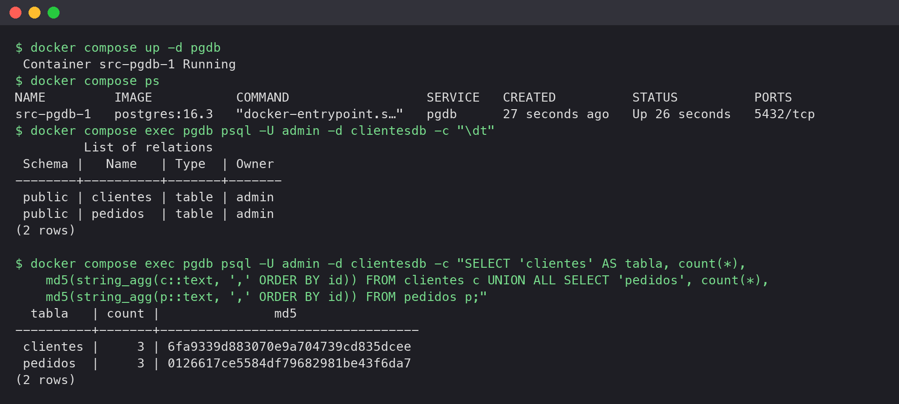
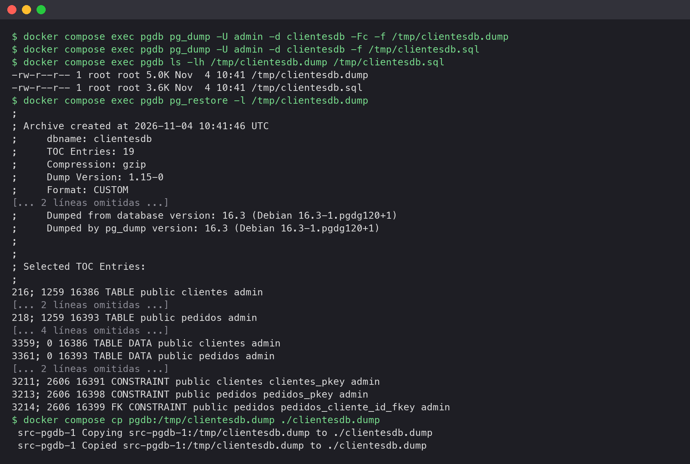
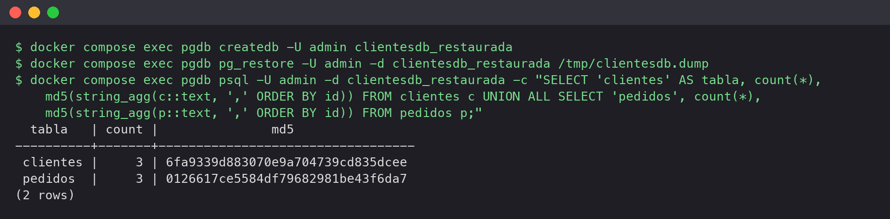
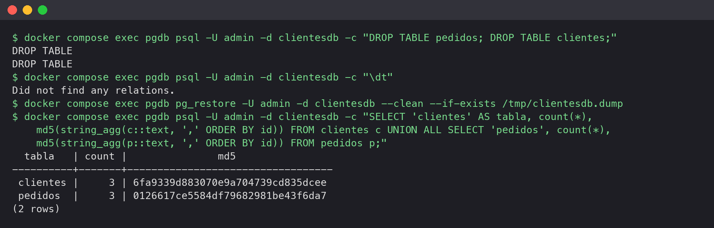
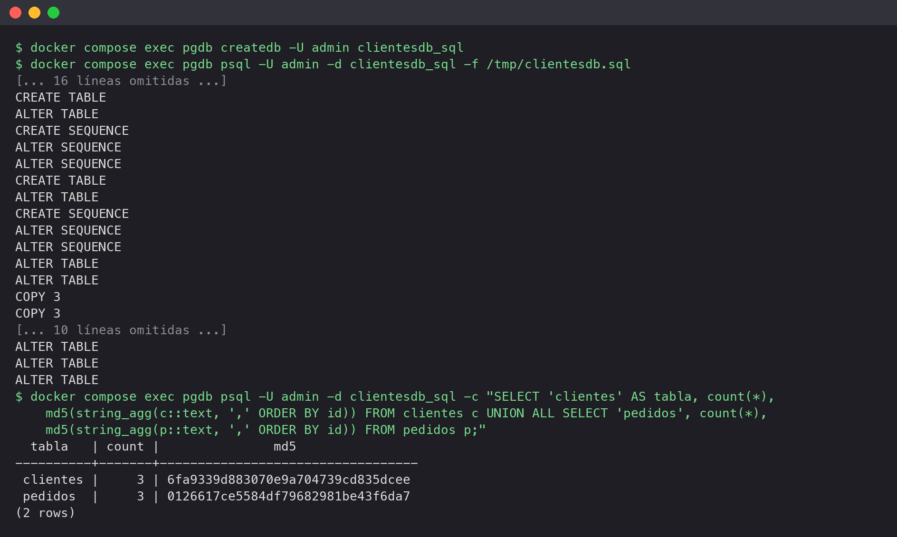

## 1. Objetivo y entorno

Se realiza la **actividad práctica 2**: hacer una copia de seguridad de una base de datos y restaurarla, tanto en una base de datos nueva como sobrescribiendo la original. Se ha trabajado por consola (alternativa permitida en el enunciado), con las mismas herramientas que utiliza pgAdmin por debajo: `pg_dump` y `pg_restore`.

La base de datos es `clientesdb` (tablas `clientes` y `pedidos`), desplegada con Docker Compose a partir del repositorio de la asignatura (`postgresql-backups/src`, imagen `postgres:16.3`). Solo se levanta el servicio `pgdb`, ya que el servicio `pgbackup` pertenece a la actividad 1. Los comandos se ejecutan **dentro del contenedor** con `docker compose exec`, lo que garantiza que las versiones de `pg_dump`, `pg_restore` y del servidor coinciden.

## 2. Pasos realizados

### Paso 1. Despliegue y estado inicial

Se levanta el servicio y se consulta el número de filas y un **resumen MD5** del contenido de cada tabla. La última línea es la **consulta de verificación**: si tras restaurar el MD5 coincide, los datos son idénticos fila a fila, no solo "parecidos".

::: paso
```bash
docker compose up -d pgdb
docker compose ps
docker compose exec pgdb psql -U admin -d clientesdb -c "\dt"
docker compose exec pgdb psql -U admin -d clientesdb -c "SELECT 'clientes' AS tabla, count(*), md5(string_agg(c::text, ',' ORDER BY id)) FROM clientes c UNION ALL SELECT 'pedidos', count(*), md5(string_agg(p::text, ',' ORDER BY id)) FROM pedidos p;"
```


:::

**Resultado:** 3 clientes y 3 pedidos; estos MD5 son la referencia para el resto de pasos.

### Paso 2. Realización de la copia de seguridad

Se generan dos copias con `pg_dump`, que toma una instantánea consistente (MVCC) sin bloquear a otros usuarios: una en **formato personalizado** (`-Fc`, comprimido, restaurable de forma selectiva con `pg_restore`) y otra en **SQL plano** (cargable con `psql`). `pg_restore -l` lista el **índice (TOC)** para comprobar la copia antes de necesitarla, y esta se lleva al anfitrión para que no viva solo en el contenedor.

::: paso
```bash
docker compose exec pgdb pg_dump -U admin -d clientesdb -Fc -f /tmp/clientesdb.dump
docker compose exec pgdb pg_dump -U admin -d clientesdb -f /tmp/clientesdb.sql
docker compose exec pgdb ls -lh /tmp/clientesdb.dump /tmp/clientesdb.sql
docker compose exec pgdb pg_restore -l /tmp/clientesdb.dump
docker compose cp pgdb:/tmp/clientesdb.dump ./clientesdb.dump
```


:::

**Resultado:** copia personalizada de 5,0 KB y SQL de 3,6 KB; el índice contiene tablas, datos, secuencias y restricciones (incluida la clave foránea).

### Paso 3. Restauración en una base de datos nueva

Es la forma más segura de comprobar una copia, porque no toca los datos originales: se crea una base de datos vacía y se restaura en ella.

::: paso
```bash
docker compose exec pgdb createdb -U admin clientesdb_restaurada
docker compose exec pgdb pg_restore -U admin -d clientesdb_restaurada /tmp/clientesdb.dump
```

A continuación se ejecuta la consulta de verificación del paso 1.


:::

**Resultado:** el recuento y los MD5 coinciden con los del paso 1.

### Paso 4. Desastre simulado y restauración sobrescribiendo

Se simula el borrado accidental de las tablas, se comprueba que han desaparecido y se recuperan con `--clean --if-exists`, que elimina los objetos existentes antes de recrearlos (y no falla si ya no existen).

::: paso
```bash
docker compose exec pgdb psql -U admin -d clientesdb -c "DROP TABLE pedidos; DROP TABLE clientes;"
docker compose exec pgdb psql -U admin -d clientesdb -c "\dt"
docker compose exec pgdb pg_restore -U admin -d clientesdb --clean --if-exists /tmp/clientesdb.dump
```

A continuación se ejecuta la consulta de verificación del paso 1.


:::

**Resultado:** los MD5 vuelven a coincidir; la recuperación es completa, incluida la clave foránea de `pedidos` hacia `clientes`.

### Paso 5. Restauración de la copia SQL plana

La copia en texto no se carga con `pg_restore`, sino con `psql`. Se restaura en otra base de datos nueva.

::: paso
```bash
docker compose exec pgdb createdb -U admin clientesdb_sql
docker compose exec pgdb psql -U admin -d clientesdb_sql -f /tmp/clientesdb.sql
```

A continuación se ejecuta la consulta de verificación del paso 1.


:::

**Resultado:** los MD5 coinciden también con la copia en SQL plano.

## 3. Equivalencia con pgAdmin

Table: Tabla 1. Equivalencia entre pgAdmin y la línea de comandos

| Acción en pgAdmin | Herramienta equivalente | Uso |
|---|---|---|
| *Backup…* (formato Custom) | `pg_dump -Fc` | Copia comprimida y restaurable de forma selectiva |
| *Backup…* (formato Plain) | `pg_dump` | Copia en texto SQL, cargable con `psql` |
| *Restore…* | `pg_restore` | Restaura una copia Custom/Tar en una BD existente |

Table: Tabla 2. Formato personalizado frente a SQL plano

| | Formato personalizado (`-Fc`) | SQL plano |
|---|---|---|
| Se restaura con | `pg_restore` | `psql` |
| Tamaño | Comprimido | Mayor |
| Restauración selectiva y paralela | Sí | No |
| Legible y editable a mano | No | Sí |

## 4. Verificación y conclusiones

Table: Tabla 3. Verificación de integridad

| Paso | Base de datos | Filas (clientes/pedidos) | MD5 clientes | MD5 pedidos | ¿Coincide con el original? |
|---|---|---|---|---|---|
| 1 | `clientesdb` (original) | 3 / 3 | `6fa9339d…` | `0126617c…` | Referencia |
| 3 | `clientesdb_restaurada` | 3 / 3 | `6fa9339d…` | `0126617c…` | Sí |
| 4 | `clientesdb` (tras el borrado) | 3 / 3 | `6fa9339d…` | `0126617c…` | Sí |
| 5 | `clientesdb_sql` | 3 / 3 | `6fa9339d…` | `0126617c…` | Sí |

::: nota
MD5 completos en las capturas.
:::

1. **Una copia solo sirve si se ha probado.** Cada restauración se verificó con el MD5 del contenido y la copia se inspeccionó antes con `pg_restore -l`.
2. **Restaurar en una base de datos nueva es lo más seguro.** No toca los datos originales; `--clean --if-exists` es la opción para sobrescribir.
3. **Son copias lógicas.** Recuperan el estado del momento de la copia, no un instante intermedio. Para eso existen la copia física (`pg_basebackup`) y el archivado de WAL (PITR), que no se han utilizado en esta práctica.
4. **La copia debe estar fuera del servidor.** Una copia que solo vive dentro del contenedor no protege frente a su pérdida; por eso se copió al anfitrión.
